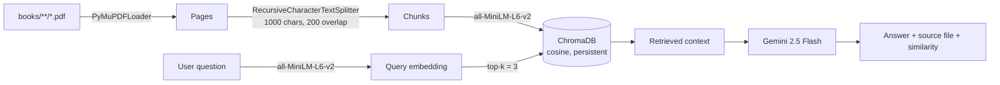

<div align="center">

# NCERT-RAG

**Ask your textbook a question. Get an answer grounded in the actual page.**


</div>

---

## What it does

NCERT-RAG is a retrieval-augmented generation (RAG) assistant for NCERT textbooks, served through a small Django web app. You type a question ("Explain reflection of light"), it searches a local vector index of the textbook PDFs, and Gemini answers using only the retrieved passages. The page shows the answer alongside the source file and the similarity score of the best-matching chunk.

The repo ships with PDFs for:

| Class | Subjects |
| --- | --- |
| Class 10 | Maths, Science |
| Class 6 | English, Hindi |

Drop more PDFs into `books/` and they are picked up on the next (re)index.

## How it works



1. **Ingest** - `src/process_pdfs.py` loads every PDF under the books directory and tags each page with its source file.
2. **Chunk** - pages are split into ~1000-character chunks with 200 characters of overlap.
3. **Embed** - `src/embeddings_manager.py` encodes chunks with the SentenceTransformer `all-MiniLM-L6-v2`.
4. **Store** - `src/Vector_store.py` writes them to a persistent ChromaDB collection (`pdf_documents`, cosine space). Indexing is skipped if the collection already has documents.
5. **Retrieve** - `src/RagRetriver.py` embeds the question and pulls the top 3 chunks.
6. **Generate** - `src/RAG.py` stuffs the chunks into a prompt and calls `gemini-2.5-flash` via `langchain-google-genai`.

## Tech stack

- **Web:** Django 6 (single view + template), Waitress for serving
- **Retrieval:** LangChain (loaders, text splitters), ChromaDB, sentence-transformers
- **Generation:** Google Gemini 2.5 Flash through `langchain-google-genai`
- **PDF parsing:** PyMuPDF

## Project structure

```text
NCERT-RAG/
├── books/                  # NCERT PDFs (class 10 maths/science, class 6 English/Hindi)
├── src/
│   ├── process_pdfs.py     # load PDFs + split into chunks
│   ├── embeddings_manager.py
│   ├── Vector_store.py     # ChromaDB wrapper
│   ├── RagRetriver.py      # query -> top-k chunks
│   ├── RAG.py              # prompt + Gemini call
│   └── rag_service.py      # glues it all together (index + ask)
├── app/                    # Django app: views.py, urls.py
├── rag/                    # Django project settings
├── templates/index.html    # question / answer UI
├── manage.py
├── serve.py                # Waitress server on 127.0.0.1:8000
└── requirements.txt
```

## Quickstart

```bash
git clone https://github.com/nabeelalikhan0/NCERT-RAG.git
cd NCERT-RAG

python -m venv .venv
# Windows: .venv\Scripts\activate    macOS/Linux: source .venv/bin/activate
pip install -r requirements.txt
```

**1. Add your Gemini API key.** The code loads a `.env` file from the `src/` folder:

```bash
# src/.env
GEMINI_API_KEY=your-key-here
```

**2. Point the indexer at the books folder.** `app/views.py` currently calls `rag.index_directory(...)` with an absolute Windows path. Change it to the `books` directory in your clone, for example:

```python
rag.index_directory("books")
```

**3. Run the server.**

```bash
python manage.py runserver
# or, with Waitress:
python serve.py
```

Open http://127.0.0.1:8000 and ask a question. The first request downloads the embedding model and indexes all PDFs, so it takes a while; later requests reuse the persisted Chroma store.

> **Note:** the vector store is persisted to `../data/vector_store`, relative to the directory you launch the server from (i.e. a `data/` folder next to the repo). Delete that folder to force a full re-index.

## Roadmap ideas

- Make the books path and vector-store path configurable via settings / env
- Build the `RAGService` once at startup instead of per request
- Show all retrieved chunks (with page numbers) as citations, not just the top one

---

<div align="center">

Built by [Nabeel Ali Khan](https://github.com/nabeelalikhan0) · [ChanakyaAI](https://www.chanakyaai.in)

</div>
